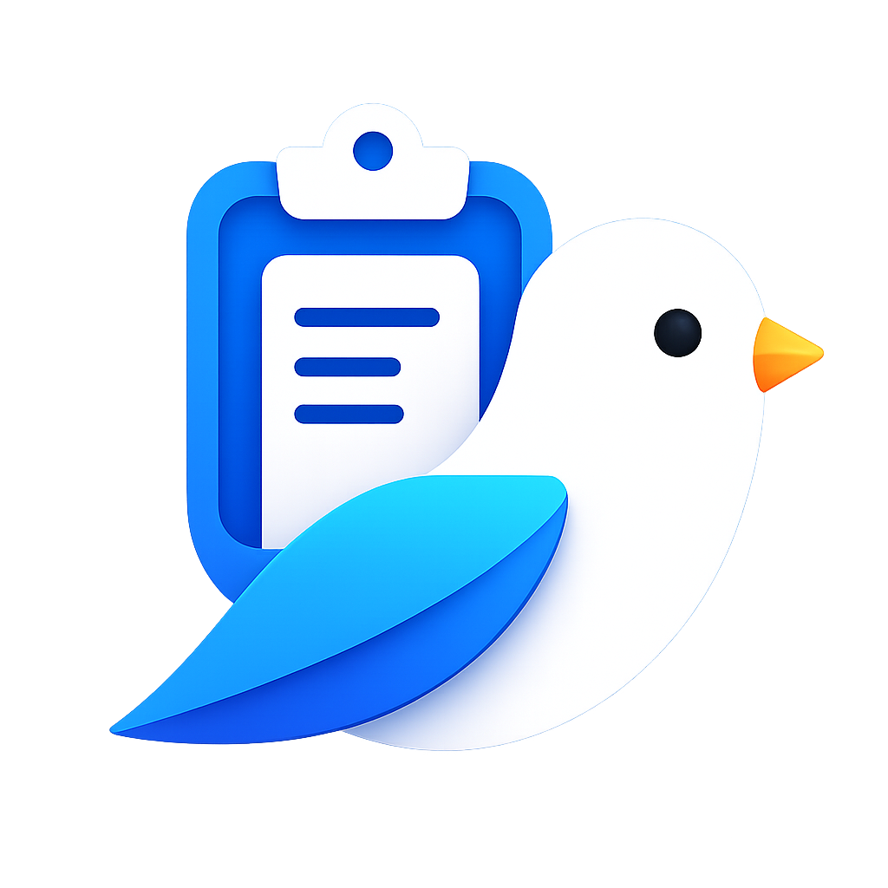

  

# Clipbird

Share your clipboard between devices.

Clipbird was previously developed in separate repositories for [desktop](https://github.com/srilakshmikanthanp/clipbirdesk) and [Android](https://github.com/srilakshmikanthanp/clipbirdroid), applications using network-based synchronization. However, at the office, I often found that my laptop and phone were connected to different networks, making clipboard sharing impossible. This inspired me to build a new version that removes the requirement for devices to be on the same local network.

While synchronization may be slower than direct network-based sharing due to the use of Bluetooth, most clipboard operations involve text, which transfers quickly. Larger items, such as images, may take longer to sync. The trade-off is greater flexibility: your devices can share a clipboard even when connected to different networks, without relying on a relay server or other intermediary infrastructure.

For downloads, setup instructions, and more, visit **[clipbird.srilakshmikanthanp.com](https://clipbird.srilakshmikanthanp.com/)**.

## Contributing

Found a bug or have an idea? Please [open an issue](https://github.com/srilakshmikanthanp/clipbird/issues). Pull requests are always welcome.

## License

Licensed under the [MIT License](LICENSE).
